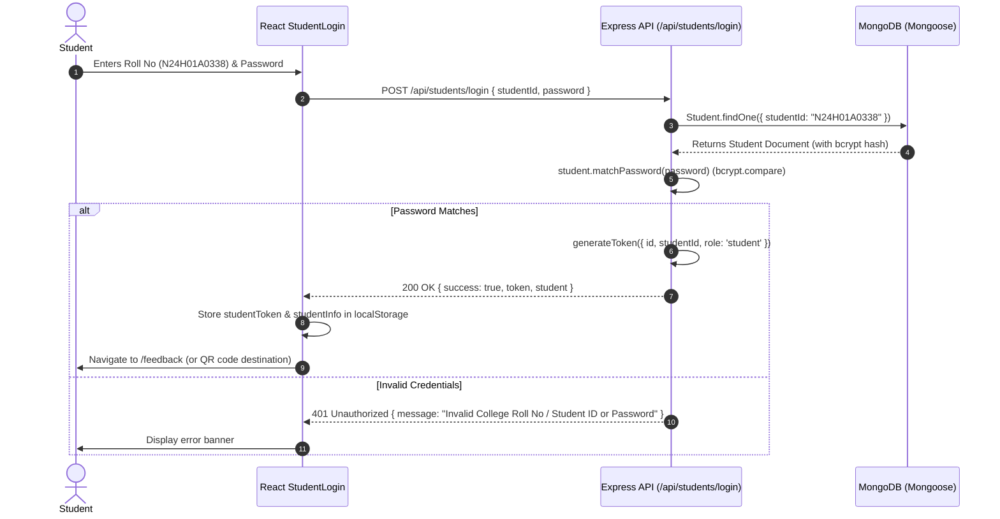

# 🎓 College Student Feedback & Faculty Evaluation Management System

[](https://nodejs.org/)
[](https://react.dev/)
[](https://vitejs.dev/)
[](https://expressjs.com/)
[](https://mongoosejs.com/)
[](https://opensource.org/licenses/MIT)

An enterprise-grade, full-stack academic evaluation and institutional quality-improvement portal tailored for universities, engineering institutes, and degree colleges. Designed with modern UX aesthetics, roll-number-based student identity management, classroom QR code distribution, and real-time analytical dashboards.

---

## 📑 Table of Contents
- [Project Overview](#-project-overview)
- [System Architecture & Techniques](#-system-architecture--techniques)
- [Folder Structure](#-folder-structure)
- [How the Login Page Works & Architecture](#-how-the-login-page-works--architecture)
  - [Architecture & Design](#architecture--design)
  - [Authentication Flow](#authentication-flow)
  - [Fixing the "Authentication Failed" Issue](#fixing-the-authentication-failed-issue)
- [Default Demo Accounts & Credentials](#-default-demo-accounts--credentials)
- [Core Features](#-core-features)
- [Installation & Setup](#-installation--setup)
- [REST API Reference](#-rest-api-reference)
- [Deployment Guide](#-deployment-guide)

---

## 🌟 Project Overview

Traditional student feedback workflows rely on paper sheets or clumsy Google Forms that lack verification, result in duplicate entries, and require manual data collation. 

This **Student Feedback Management System** solves these challenges by providing:
1. **Authenticated Academic Roll Numbers**: Verification that each student belongs to a specific department and semester.
2. **Classroom QR Code Distribution**: Instructors and department heads generate dynamic QR codes that students scan on their mobile devices to jump directly into the evaluation form.
3. **Multi-Criteria Faculty Evaluation**: Structured rating metrics covering pedagogy, subject mastery, communication, and overall effectiveness.
4. **Institutional Quality Dashboard**: Visual performance charts, department breakdowns, and exportable CSV reports for accreditation (NAAC/NBA/ABET) committees.

---

## 🛠️ System Architecture & Techniques

### Frontend Architecture
- **Framework**: React 18 with Vite for ultra-fast Hot Module Replacement (HMR) and optimized bundling.
- **Styling**: Bespoke Vanilla CSS Design System with dark glassmorphic surfaces, curated HSL color tokens, responsive CSS grids, and smooth micro-interactions.
- **Icons**: Lucide React for consistent modern iconography.
- **QR Code Engine**: `qrcode.react` (`QRCodeSVG`) for high-resolution vector rendering and PNG/SVG direct downloads.
- **HTTP Client**: Axios with local proxying to the backend and integrated error interception.
- **Routing**: `react-router-dom` v6 with SPA history rewrites configured for local development and Vercel cloud deployment.

### Backend Architecture
- **Runtime**: Node.js & Express.js REST API with modular route handlers.
- **Database & ODM**: MongoDB with Mongoose schemas and strict validation.
- **Embedded In-Memory MongoDB Fallback**: Built-in support via `mongodb-memory-server` allowing the application to run out-of-the-box on developer machines even if a standalone local MongoDB service or external connection is not installed.
- **Authentication**: Stateless JSON Web Tokens (JWT) signed with HMAC-SHA256.
- **Password Security**: `bcryptjs` with salt round 10 for one-way password hashing.
- **CORS & Tunneling**: Integrated support for cross-origin access and mobile LAN IP detection (`0.0.0.0`) for live mobile QR scanning over Wi-Fi.

---

## 📁 Folder Structure

```text
CDU_MINI_PROJECT/
├── package.json                          # Unified root scripts (backend, frontend, seed)
├── vercel.json                           # Root SPA redirect rules for cloud deployment
├── README.md                             # Comprehensive project documentation
└── student-feedback-management/
    ├── backend/                          # Express.js REST API Server
    │   ├── config/
    │   │   └── db.js                     # MongoDB connection with In-Memory fallback
    │   ├── middleware/
    │   │   └── authMiddleware.js         # JWT verification & role authorization
    │   ├── models/
    │   │   ├── Admin.js                  # Administrator schema & password hashing
    │   │   ├── Feedback.js               # Multi-factor evaluation feedback schema
    │   │   └── Student.js                # Student schema with uppercase Roll Number
    │   ├── routes/
    │   │   ├── adminRoutes.js            # Admin authentication & dashboard analytics
    │   │   ├── feedbackRoutes.js         # Feedback submission, retrieval & CSV export
    │   │   └── studentRoutes.js          # Student registration, login & profile
    │   ├── .env.example                  # Environment variable configuration template
    │   ├── package.json                  # Backend dependencies & npm scripts
    │   ├── seed.js                       # Standalone database population script
    │   └── server.js                     # Server entrypoint with auto-seeding & network info
    └── frontend/                         # React 18 Single Page Application
        ├── public/
        │   └── vercel.json               # Frontend-specific SPA routing fallback
        ├── src/
        │   ├── components/
        │   │   ├── FeedbackTable.jsx     # Searchable, filterable evaluations table
        │   │   └── Navbar.jsx            # Dynamic navigation bar with active sessions
        │   ├── pages/
        │   │   ├── AdminLogin.jsx        # Admin credential login portal
        │   │   ├── Dashboard.jsx         # Dean/HOD analytics charts & metrics
        │   │   ├── Feedback.jsx          # 4-factor star rating evaluation form
        │   │   ├── Home.jsx              # Landing page with workflow overview
        │   │   ├── QRGenerator.jsx       # QR Code creation hub with LAN IP detection
        │   │   └── StudentLogin.jsx      # Roll number student authentication
        │   ├── App.jsx                   # Application routing and layout wrapper
        │   ├── index.css                 # Master Design System (CSS variables, glassmorphism)
        │   └── main.jsx                  # React DOM root entrypoint
        ├── package.json                  # Frontend dependencies
        ├── vercel.json                   # Client redirect configuration
        └── vite.config.js                # Vite development server & API proxy config
```

---

## 🔐 How the Login Page Works & Architecture

### Architecture & Design
The login experience is bifurcated into two specialized portals:

1. **Student Portal (`/student-login`)**:
   - Uses **College Roll Numbers** (e.g., `N24H01A0338`) rather than arbitrary usernames.
   - Dual-tab mode: **Existing Student Sign In** and **+ Register New Student**.
   - Automatic input normalization: Roll numbers are automatically formatted to uppercase (`toUpperCase()`) and trimmed of whitespace.
   - Demo Quick-Selector Chips: One-click buttons to auto-populate sample student credentials for instantaneous evaluation testing.
   - Password Visibility Toggle: Eye/Eye-off switch to avoid mistyping passwords.
   - QR Code Deep Linking: If a student accesses the portal via a classroom QR code (e.g. `?redirect=/feedback?dept=...`), the target URL is stored in `sessionStorage` and automatically navigated to once authenticated.

2. **Admin Portal (`/admin-login`)**:
   - Secured administrative portal for department heads, deans, and academic committees.
   - Grants access to the institutional quality analytics dashboard, rating distributions, and student submission audit logs.

### Authentication Flow


---

### 🔍 Fixing the "Authentication Failed" Issue

If you encountered the red error banner:
> **"Authentication failed. Please check your College Roll No and Password."**

Here is exactly what was happening and how it was resolved:

#### 1. What Caused the Issue?
- **Backend Server Offline**: When the frontend runs independently (e.g. `npm run dev` in `frontend/`), calls to `/api/students/login` attempt to reach `http://localhost:5000`. If the backend server was not started, Vite's proxy returned a network failure (`504 Gateway Timeout` or `ECONNREFUSED`).
- **Generic Fallback Catch Block**: In previous code, if `error.response?.data?.message` was absent due to a server connection failure, the catch block used a generic fallback message: `"Authentication failed. Please check your College Roll No and Password."` This misled users into thinking their roll number or password was wrong, when in fact the backend server was simply not running.
- **Premature Server Listen**: In the backend, `app.listen()` was previously called before the database connection and default account auto-seeding had completely finished. If a login was submitted in the first few seconds of startup, the database was still querying or empty.

#### 2. The Solutions Implemented:
1. **Async Startup Sequence (`server.js`)**:
   The server startup is now wrapped in `startServer()`, which guarantees `await connectDB()` and `await autoSeedIfEmpty()` complete **before** the server opens port 5000:
   ```javascript
   const startServer = async () => {
     await connectDB();
     await autoSeedIfEmpty();
     app.listen(PORT, '0.0.0.0', () => { ... });
   };
   ```
2. **Resilient Embedded MongoDB Fallback (`config/db.js`)**:
   If a local MongoDB daemon is not running on your machine, the system automatically falls back to an embedded in-memory MongoDB server with dynamic port allocation so it never fails due to port conflicts.
3. **Live Server Health Detection (`StudentLogin.jsx` & `AdminLogin.jsx`)**:
   The login page now monitors the backend connection via `/api/health`. If the backend is unreachable, a prominent notice appears:
   > `⚠️ Backend Server is Offline (Port 5000). Start backend with: cd student-feedback-management/backend && npm start`
4. **Differentiated Error Messages**:
   Network errors, connection timeouts, and offline states now explicitly inform the user to check their backend process rather than blaming credentials.
5. **Interactive Password Toggle & Badges**:
   Added an Eye icon to view the typed password and added an explicit `Password: student123` badge to sample roll number chips.

---

## 🔑 Default Demo Accounts & Credentials

### 👨‍🎓 Student Sample Accounts
| College Roll No | Password | Student Name | Department | Semester |
|---|---|---|---|---|
| `N24H01A0338` | `student123` | Rahul Sharma | Mechanical Engineering | Semester 4 |
| `N24H01B0338` | `student123` | Priya Reddy | Computer Science & Engineering | Semester 6 |
| `N24H01A0501` | `student123` | Ananya Verma | Electronics & Communication | Semester 6 |
| `N24H01A0102` | `student123` | Karthik Kumar | Information Technology | Semester 4 |

> 💡 **New Student?** You can register **any** college roll number at any time using the **"+ Register New Student"** tab on the login screen.

### 🛡️ Administrator Account
| Username | Password | Role & Permissions |
|---|---|---|
| `admin` | `admin123` | Full Institutional Dashboard, Department Analytics, and Submissions Audit |

---

## 🚀 Installation & Setup

### Prerequisites
- [Node.js](https://nodejs.org/) (v16, v18, or v20+)
- npm or yarn

### Method A: Quick Start via Root Scripts
From the root repository directory (`CDU_MINI_PROJECT/`):

1. **Install all dependencies**:
   ```bash
   npm run install:all
   ```

2. **Start Backend Server**:
   ```bash
   npm run backend
   # Or: npm start
   # Runs on http://localhost:5000
   ```

3. **Start Frontend Server** (in a second terminal):
   ```bash
   npm run frontend
   # Runs on http://localhost:3000
   ```

---

### Method B: Manual Folder Setup

#### 1. Setup Backend
```bash
cd student-feedback-management/backend
npm install

# (Optional) Seed fresh initial sample data
npm run seed

# Start backend server
npm start
# -> Backend starts on http://localhost:5000
```

#### 2. Setup Frontend
```bash
cd student-feedback-management/frontend
npm install

# Start Vite dev server
npm run dev
# -> Frontend starts on http://localhost:3000
```

Now open [http://localhost:3000](http://localhost:3000) in your web browser.

---

## 📡 REST API Reference

| Method | Endpoint | Description | Access |
|---|---|---|---|
| `POST` | `/api/students/login` | Authenticate student by Roll No & return JWT | Public |
| `POST` | `/api/students/register` | Register new student profile & return JWT | Public |
| `GET` | `/api/students/profile` | Retrieve profile of authenticated student | Student (JWT) |
| `POST` | `/api/admin/login` | Authenticate administrator & return JWT | Public |
| `GET` | `/api/admin/dashboard` | Computed institutional statistics & star distribution | Admin (JWT) |
| `POST` | `/api/feedback` | Submit multi-factor course & faculty evaluation | Student / Public |
| `GET` | `/api/feedback` | Retrieve & filter all submitted evaluations | Admin (JWT) |
| `GET` | `/api/feedback/student/:rollNo` | Get submission history for specific roll number | Student / Public |
| `DELETE` | `/api/feedback/:id` | Delete an evaluation record | Admin (JWT) |
| `GET` | `/api/health` | System health, uptime & timestamp check | Public |

---

## 🌐 Deployment Guide

### Vercel Deployment (Frontend)
The repository includes pre-configured `vercel.json` rewrite files in the root and in `student-feedback-management/frontend/` to route all single-page client paths (`/student-login`, `/feedback`, `/dashboard`, `/qr-generator`) through `index.html`.

1. Push your repository to GitHub.
2. In [Vercel](https://vercel.com/), import the repository.
3. Set **Root Directory** to `student-feedback-management/frontend`.
4. Deploy!

### Production Database (MongoDB Atlas)
To use a production MongoDB instance instead of the local/embedded fallback:
1. Create a free cluster on [MongoDB Atlas](https://www.mongodb.com/cloud/atlas).
2. Set the `MONGO_URI` environment variable in your backend `.env`:
   ```env
   MONGO_URI=mongodb+srv://<username>:<password>@cluster0.mongodb.net/student_feedback?retryWrites=true&w=majority
   JWT_SECRET=your_production_secret_key_2026
   PORT=5000
   ```

---

## 👨‍💻 Contributors & Maintenance
- **Author**: Rafik ([@DRafi2006](https://github.com/DRafi2006))
- **Repository**: [DRafi2006/Student-Feedback-Management-System](https://github.com/DRafi2006/Student-Feedback-Management-System)
- **License**: MIT
